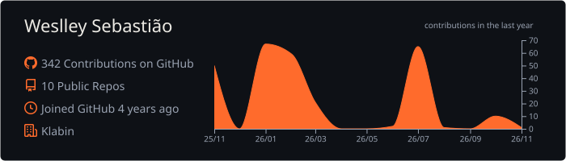
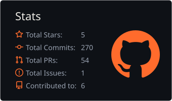
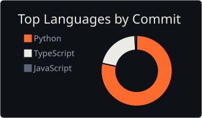

# Olá, eu sou o Weslley 👋

**Desenvolvedor Python & Engenheiro de IA** · Digital Lab da [Klabin](https://www.klabin.com.br/)

Passei um tempo trabalhando com o público antes da faculdade, e foi na Ciência da Computação que descobri minha verdadeira paixão: **tecnologia**.
Hoje construo **plataformas de agentes de IA generativa** que saem do protótipo e rodam em produção — da arquitetura e do backend em Python até a observabilidade e o custo na nuvem.

Gosto de entender o **porquê** das coisas: não basta funcionar, tem que fazer sentido.

---

## 🧠 No que eu trabalho

- **Plataformas multiagente** — orquestração de agentes especialistas, classificação de intenção com LLM e comunicação entre agentes via **A2A** e ferramentas via **MCP**
- **Backend assíncrono em Python** — APIs com FastAPI, gestão de sessão e execução de agentes em modelo assíncrono
- **RAG e bases de conhecimento** — consulta a documentos com citação de fontes, usando Bedrock Knowledge Bases
- **Contexto e memória de LLMs** — controle de sessões longas, memória de longo prazo e embeddings
- **Observabilidade** — dashboards, métricas de experiência do usuário e APM no Datadog, investigação de memória e latência
- **Cloud e FinOps** — Kubernetes no EKS/Fargate, dimensionamento de pods e tagging de recursos para atribuição de custos

---

## 🛠️ Tecnologias e Ferramentas

#### Linguagens

#### IA Generativa

#### Backend e Dados

#### Cloud, Infra e Observabilidade

#### Estudando agora

---

## 🚀 Projetos em Destaque

- **Luna AI** → Plataforma corporativa de agentes de IA da Klabin, **em produção desde 2026**. Orquestrador que encaminha cada pedido ao agente especialista certo, com agentes se comunicando via A2A, ferramentas via MCP e integração com sistemas corporativos. Participei da arquitetura e redesenhei a execução dos agentes para um modelo **assíncrono**, o que deixou a plataforma mais estável.
- **Assistente de governança com RAG** → Assistente para a alta liderança que consulta normas e atas, cita as fontes e organiza respostas num painel de trabalho ao lado do chat.
- **ChatLLM** → Sistema completo de **orquestração, criação e execução de agentes de IA**, focado em modularidade e automação.
- **Coordina** → Plataforma para criação e execução de agentes de IA inteligentes e personalizáveis.
- **LLM do zero** *(estudo)* → Trilha para entender modelos de linguagem por dentro, do bigram ao GPT treinado em português, numa GPU doméstica.

---

## 📊 GitHub Stats

  

  
  

---

## 📫 Contato

---

⭐ _“Aprender, entender o porquê e construir — um commit de cada vez.”_
